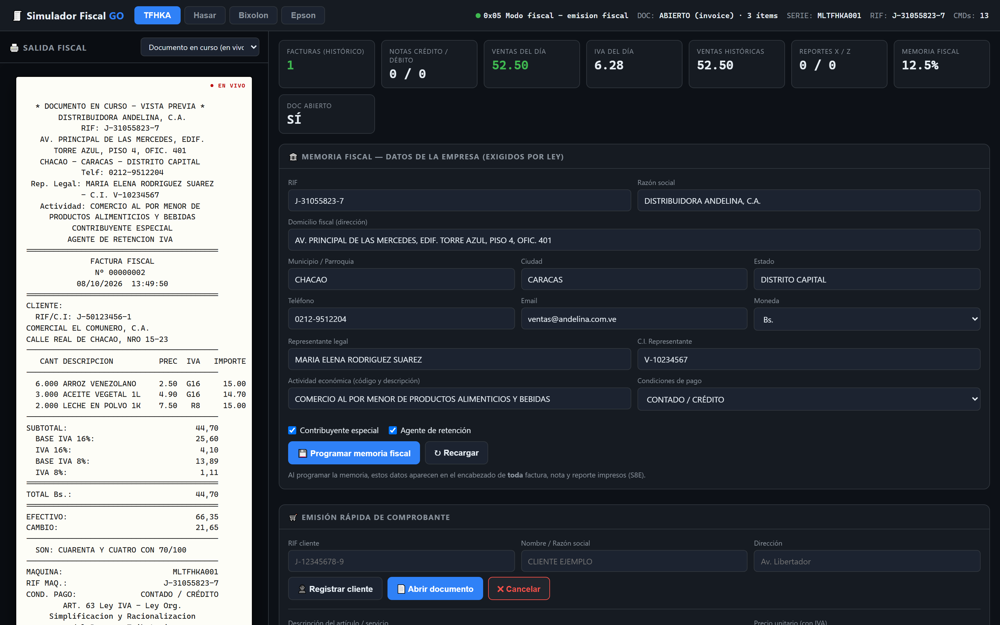
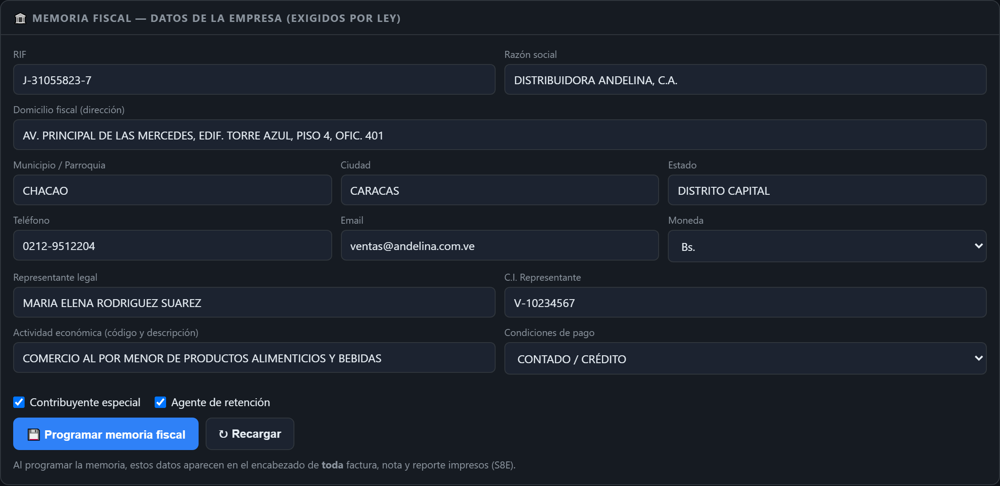
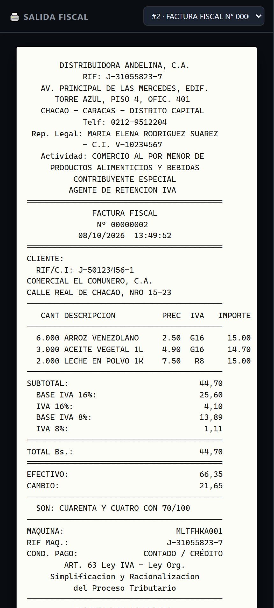
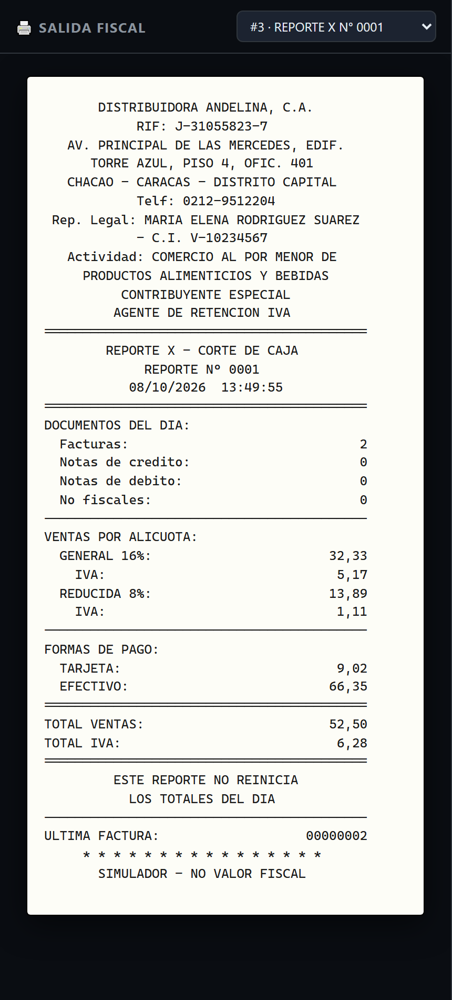
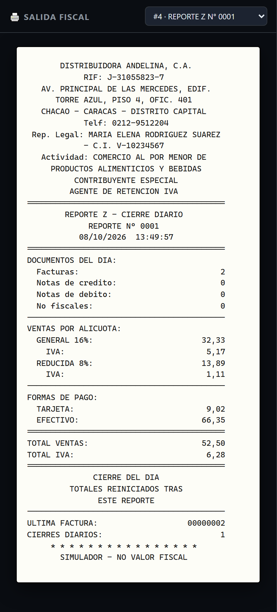
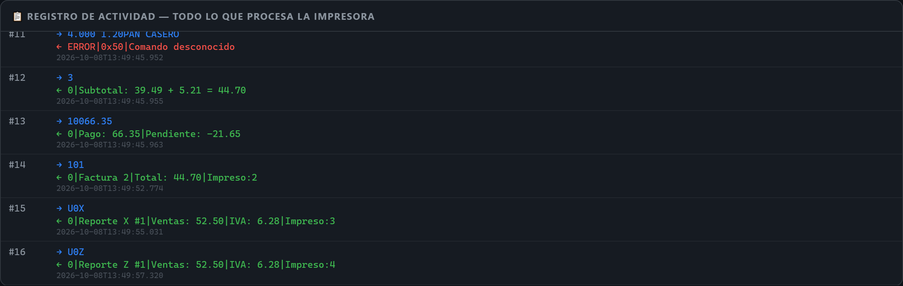

# SimuladorFiscalGO

Simulador de impresoras fiscales para Venezuela, escrito en Go. Mismo panel, mismos protocolos y **misma salida byte a byte** que la referencia [SimuladorFiscalPY](../README.md), pero compilado a **un único binario** sin dependencias en tiempo de ejecución. Soporta las marcas TFHKA, Hasar SMH/P-615F, Bixolon SRP-270 y Epson TM2000, con panel web, memoria fiscal programable, papel virtual y reportes X/Z.

**Licencia:** MIT — ver [LICENSE](LICENSE).

---

## Compilar (un solo binario)

```bash
go build -o simuladorfiscal.exe ./cmd/simuladorfiscal
```

Requisitos: Go 1.26+. El binario incluye la UI del panel embebida (`go:embed`), no necesita Python, Node ni archivos externos.

## Uso

```bash
./simuladorfiscal.exe                          # panel en http://127.0.0.1:8080
./simuladorfiscal.exe panel --port 9000
./simuladorfiscal.exe panel --host 0.0.0.0 --port 8080 --no-browser
./simuladorfiscal.exe sim --model tfhka --port COM5 --log sim.log
./simuladorfiscal.exe sim --model hasar --mode test
./simuladorfiscal.exe version
```

- **panel** (por defecto): sirve el panel web y la API REST; abre el navegador salvo con `--no-browser`.
- **sim**: CLI serie; si el puerto (`--port`, por defecto `COM5`) no está disponible, cae a **modo interactivo** por stdin/stdout. El transporte serie usa [`go.bug.st/serial`](https://github.com/bugst/go.bug.st/serial).

## Arranque rápido con .env y .bat (Windows)

Edita [`.env`](.env) para elegir la configuración:

```ini
HOST=127.0.0.1
PORT=8080        # si está ocupado, se busca el siguiente libre
DATA_DIR=data
NO_BROWSER=0     # 1 = no abrir el navegador
```

Luego ejecuta doble clic en [`compilar_y_ejecutar.bat`](compilar_y_ejecutar.bat). El script:

1. Lee `.env` (si falta o `PORT` no es numérico, usa los valores por defecto).
2. **Valida el puerto con `netstat`**: si el asignado está ocupado, prueba el siguiente (`8081`, `8082`, … hasta +200) y lo indica por consola, p. ej. `(del .env: 8080, usado: 8082)`.
3. Compila `simuladorfiscal.exe` con `go build` (si no hay Go en el PATH, reutiliza el binario existente).
4. Levanta el panel en el puerto resuelto; `Ctrl+C` lo detiene.

## Capturas del panel

### Panel principal



Vista general del panel: a la izquierda la **salida fiscal** (papel virtual con vista previa en vivo del documento en curso) y a la derecha los contadores del día, los del histórico y las tarjetas de estado. Arriba se elige la marca simulada (TFHKA / Hasar / Bixolon / Epson), cada una con su propio estado persistido.

### Memoria fiscal (datos de la empresa)



Formulario con los datos que exige la ley y que la máquina guarda en su memoria fiscal: RIF, razón social, domicilio, municipio/ciudad/estado, teléfono, representante legal + cédula, actividad económica, contribuyente especial y agente de retención. Al programarlos, aparecen en el **encabezado de toda factura, nota y reporte** impresos.

### Factura fiscal impresa



La factura tal como la imprime la máquina: encabezado legal, cliente, tabla de ítems con la alícuota de cada uno (G16 / R8 / exento), desglose de IVA por alícuota, total, forma de pago con vuelto y el **monto en letras**. Se genera con los comandos reales del protocolo de la marca seleccionada.

### Reporte X (corte de caja)



Reporte de lectura: muestra los totales del día (documentos, ventas por alícuota, IVA y formas de pago) **sin reiniciarlos**. Sirve para cuadrar caja a mitad de turno.

### Reporte Z (cierre del día)



Cierre fiscal del día: mismos totales que el X, pero **reinicia los acumulados diarios**. Los contadores históricos (facturas consecutivas y ventas totales de por vida) se conservan.

### Registro de actividad



Log en vivo de todo lo que procesa la impresora: cada comando con su respuesta, en el protocolo real de la marca seleccionada. Útil para depurar integraciones y ver exactamente qué viaja por el puerto.

---

## Panel web (recomendado)

```bash
./simuladorfiscal.exe                    # http://127.0.0.1:8080
./simuladorfiscal.exe panel --port 9000
./simuladorfiscal.exe panel --host 0.0.0.0 --port 8080 --no-browser
```

El panel muestra, en una sola ventana:

- **Salida fiscal (lado izquierdo):** el papel virtual con la factura/nota/reportes tal como los imprimiría la máquina, con encabezado legal, desglose de IVA por alícuota, monto en letras y pie de ley. Mientras el documento está abierto se ve una **vista previa en vivo**.
- **Registro de actividad:** todo lo que procesa la impresora, comando por comando con su respuesta.
- **Memoria fiscal:** los datos que exige la ley; al programarlos aparecen en el encabezado de todo documento impreso.
- **Emisión rápida:** cliente, ítems con alícuota, subtotal, pago, cierre — genera los comandos reales del protocolo de cada marca.
- **Reportes X y Z:** X lee sin reiniciar; Z cierra el día (reinicia acumulados diarios pero conserva contadores históricos).
- **Consola de comandos:** envío de comandos crudos del protocolo real.
- **Selector de marca:** TFHKA / Hasar / Bixolon / Epson, cada uno con su propio estado persistido en `data/state_<marca>.json`.

## API REST (para integración con sistemas externos)

| Método | Ruta | Descripción |
|--------|------|-------------|
| GET  | `/api/state?brand=X` | Estado completo (contadores, documento, memoria) |
| GET  | `/api/history?brand=X&since=N` | Log de comandos desde la secuencia N |
| GET  | `/api/preview?brand=X` | Vista previa del documento en curso |
| GET  | `/api/jobs?brand=X` | Documentos impresos (metadatos) |
| GET  | `/api/job/<id>?brand=X` | Líneas de papel de un job |
| GET  | `/api/company?brand=X` | Memoria fiscal programada |
| POST | `/api/command` | `{"brand":"tfhka","command":"101"}` comando crudo |
| POST | `/api/company` | `{"brand":"tfhka","company":{...}}` programar memoria |
| POST | `/api/sale` | `{"brand":"tfhka","action":"item","params":{...}}` paso de venta |
| POST | `/api/report` | `{"brand":"tfhka","type":"x"\|"z"}` imprimir reporte |

Acciones de `/api/sale`: `open`, `customer`, `item`, `subtotal`, `payment`, `close`, `status`, `cancel`, `drawer`, `report`.

Las respuestas JSON son **idénticas byte a byte** a las de la referencia Python: mismas claves en el mismo orden, mismos separadores (`", "` / `": "`) y los floats con formato `repr` de Python (`220.0`, no `220`).

## CLI serie (modo interactivo / serie real)

```bash
./simuladorfiscal.exe sim --model tfhka --port COM5 --log sim.log
./simuladorfiscal.exe sim --model hasar --port COM3
./simuladorfiscal.exe sim --model bixolon --port COM7 --baud 19200
./simuladorfiscal.exe sim --model epson --port COM9 --baud 115200
./simuladorfiscal.exe sim --model tfhka --port COM5 --mode test
```

Si el puerto no se puede abrir, imprime el motivo y continúa en modo interactivo:

```
TFHKA> S1
  <- 0x04|0x00
TFHKA> !   1.000     3.50CAFE
  <- 0|Item|CAFE|1.000|3.50|0.48|3.50
```

## Pruebas

```bash
go test ./...
```

Cubre los 4 protocolos (TFHKA ASCII, Hasar/Bixolon/Epson IxBatch `@...`), notas crédito/débito, documentos no fiscales, reportes X/Z, formato numérico Python (`pyfmt`) y la serialización JSON. Los tests **golden** comparan contra archivos generados desde la referencia Python (`testdata/golden/`, 20 archivos): comandos/respuestas de los 4 protocolos, papel de facturas/reportes y monto en letras, **byte a byte**.

La UI se verifica además en 7 viewports (1920×1080 → 390×844, incluyendo laptop 15"): sin overflow horizontal, sin secciones recortadas, header en dos filas desde ≤1100 px y colapsado de grids en los breakpoints correctos:

```bash
python tools/responsive_check.py --base http://127.0.0.1:8082   # CHECK_EXIT=0
```

### Paridad con la referencia Python

`tools/golden/gen_golden.py` (en la raíz del repo) regenera el oro desde el proyecto Python; la suite Go debe coincidir sin diferencias. Además, `e2e_check.py` ejecuta el mismo flujo HTTP (empresa → factura → pago → cierre → X → Z) contra el panel Go y contra el panel Python y difunde las respuestas crudas: el diff debe quedar en 0 líneas.

```bash
# panel Go
./simuladorfiscal.exe panel --port 8091 --no-browser --data-dir data
# panel Python (raíz del repo)
python panel.py --port 8092 --no-browser --data-dir /tmp/py_e2e_data
# mismo flujo contra ambos y diff
python e2e_check.py http://127.0.0.1:8091 out_go.json
python e2e_check.py http://127.0.0.1:8092 out_py.json
diff out_go.json out_py.json   # sin diferencias
```

## Regenerar las capturas

```bash
./simuladorfiscal.exe panel --no-browser --port 8091   # en una terminal
python tools/shots.py                                  # escribe img/*.png
```

Requiere [`playwright`](https://playwright.dev/python/) (`pip install playwright && playwright install chromium`).

## Semántica de contadores

- **Históricos** (nunca se reinician): `invoice_counter`, `credit_note_counter`, `total_sales`, `total_tax` — facturas consecutivas y ventas acumuladas de por vida.
- **Diarios** (los reinicia solo el reporte Z): `daily_sales`, `daily_invoices`, `tax_totals`, `payment_totals` — lo que muestran los reportes X/Z.
- El estado completo, la memoria fiscal y los jobs de impresión se persisten en `data/state_<marca>.json` tras cada comando (escritura atómica).

## Modelos soportados

### TFHKA (The Factory HKA)
- Protocolo ASCII: ítems con prefijo de tasa (`!` general 16%, `"` reducida 8%, `#` adicional 30, espacio exento)
- Subtotal `3`, forma de pago `103<medio>`, pago `100xx.xx`, cierre `101`, reportes `U0X`/`U0Z`, status `S1`-`S8P`

### Hasar SMH/P-615F · Bixolon SRP-270 · Epson TM2000
- Protocolo IxBatch: `@OpenFiscalReceipt`, `@CustomerData|rif|nombre|dir`, `@PrintLine|desc|cant|precio|tasa`, `@AddPayment|monto|metodo`, `@Close`, `@Status`, `@PrintXReport`, `@PrintZReport`
- Epson envuelve toda respuesta con `0xSTATUS|0xERROR|`

## Estructura del proyecto

```
SimuladorFiscalGO/
├── cmd/simuladorfiscal/
│   └── main.go                 # CLI del binario único (panel + sim + version)
├── internal/
│   ├── protocol/               # Constantes y parsers (TFHKA / IxBatch)
│   ├── state/                  # Estado interno + memoria fiscal + jobs
│   ├── render/                 # Papel virtual: facturas y reportes X/Z
│   ├── simulator/              # Enrutado, handlers, jobs de impresión
│   ├── persistence/            # Guardado atómico en disco
│   ├── web/                    # Servidor HTTP + API REST + static/index.html
│   ├── pyfmt/                  # Formato numérico con paridad Python
│   └── orderedmap/             # JSON con orden de inserción de claves
├── testdata/golden/            # Oro generado desde la referencia Python
├── tools/shots.py              # Generador de las capturas
├── img/                        # Capturas del panel (usadas en este README)
├── data/                       # Estado persistido por marca
├── go.mod / go.sum
├── LICENSE                     # MIT
└── README.md
```
